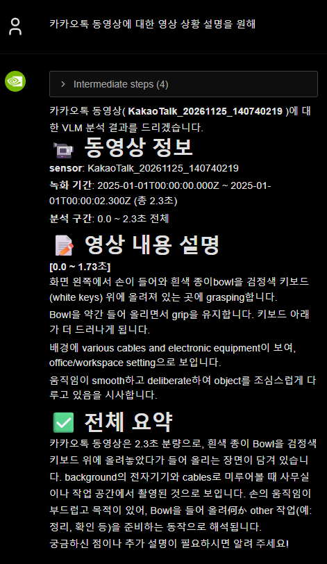
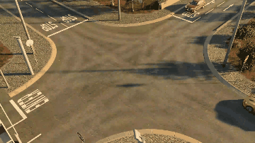
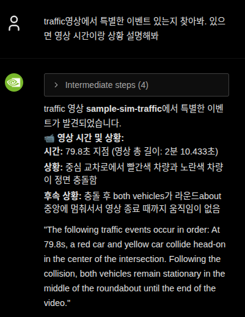

# Jetson AGX Thor VSS 실습

NVIDIA VSS 3.3.0의 `base` 프로필을 Jetson AGX Thor에서 실행하고, 샘플 영상에 자연어로 질문한 실습입니다.

- **환경** — Jetson Linux 39.2.1, Docker 29.1.3, Docker Compose v2.39.1
- **영상 분석** — Thor의 RT-VLM에서 Cosmos3 Nano Reasoner 실행
- **웹 채팅** — NemoClaw와 OpenClaw를 VSS 웹 UI에 연결
- **원격 접속** — Windows와 VS Code에서 SSH 포트 포워딩으로 VSS 웹 UI 열기

## 실습 결과

Docker 컨테이너에서 `GPU 0: NVIDIA Thor`를 확인했습니다. NGC 샘플 `warehouse_safety_0001.mp4`를 등록한 뒤 CLI에서 작업자의 안전모 착용 여부를 물었고, 모델은 안전모를 착용했다고 응답했습니다. 이후 웹 UI에서 영상을 보며 질문할 수 있도록 NemoClaw 채팅을 연결했습니다.

## 웹 채팅 성공 사례

### 1. 카카오톡 영상 · 짧은 장면 설명

<table>
  <thead>
    <tr><th>원본 영상 · 약 2.3초</th><th>VSS 질문과 답변</th></tr>
  </thead>
  <tbody>
    <tr>
      <td align="center" valign="top"></td>
      <td valign="top"></td>
    </tr>
  </tbody>
</table>

VSS는 손이 키보드 근처의 흰색 용기를 잡아 들어 올리는 장면이라고 답했습니다. [원본 MP4](assets/kakao-video.mp4)

### 2. 교통 시뮬레이션 · 충돌 장면과 발생 시점

<table>
  <thead>
    <tr><th>원본 발췌 · 75.8–84.8초</th><th>VSS 질문과 답변</th></tr>
  </thead>
  <tbody>
    <tr>
      <td align="center" valign="top"></td>
      <td valign="top"></td>
    </tr>
  </tbody>
</table>

VSS는 **79.8초**에 빨간색 차량과 노란색 차량이 충돌했다고 답했습니다. 왼쪽 영상은 충돌 전후 **9초**를 발췌한 장면입니다. [NVIDIA NGC에서 전체 샘플 받기](https://docs.nvidia.com/vss/getting-started/quickstart#download-sample-data-from-ngc)

[명령어와 재현 절차](docs/thor-vss-lab.md) · [NVIDIA VSS Quickstart](https://docs.nvidia.com/vss/getting-started/quickstart)
