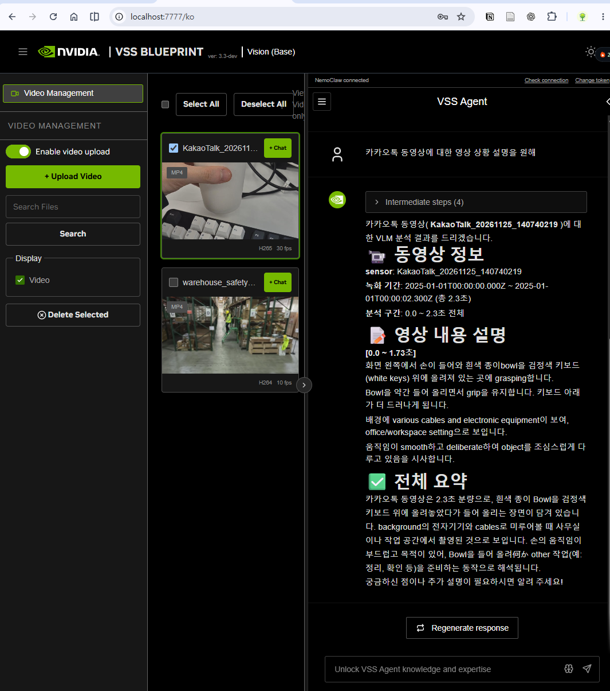
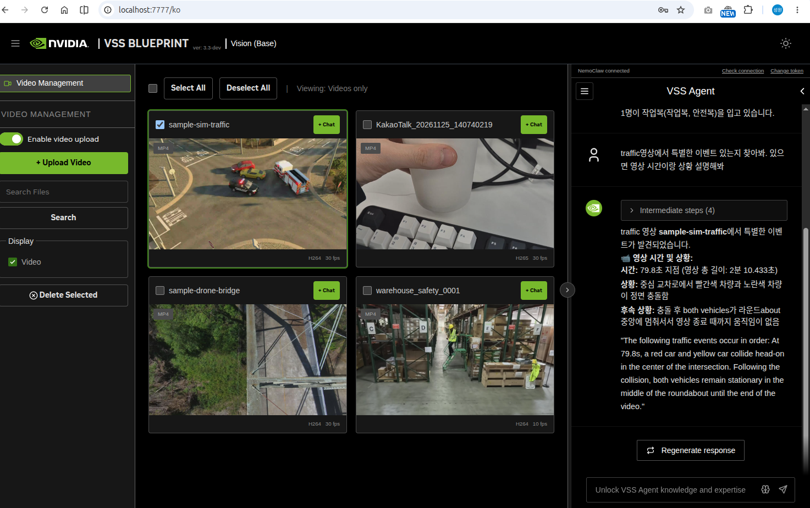

# Jetson AGX Thor VSS 실습

NVIDIA VSS 3.3.0의 `base` 프로필을 Jetson AGX Thor에서 실행하고, 샘플 영상에 자연어로 질문한 실습입니다.

- **환경** — Jetson Linux 39.2.1, Docker 29.1.3, Docker Compose v2.39.1
- **영상 분석** — Thor의 RT-VLM에서 Cosmos3 Nano Reasoner 실행
- **웹 채팅** — NemoClaw와 OpenClaw를 VSS 웹 UI에 연결
- **원격 접속** — Windows와 VS Code에서 SSH 포트 포워딩으로 VSS 웹 UI 열기

## 실습 결과

Docker 컨테이너에서 `GPU 0: NVIDIA Thor`를 확인했습니다. NGC 샘플 `warehouse_safety_0001.mp4`를 등록한 뒤 CLI에서 작업자의 안전모 착용 여부를 물었고, 모델은 안전모를 착용했다고 응답했습니다. 이후 웹 UI에서 영상을 보며 질문할 수 있도록 NemoClaw 채팅을 연결했습니다.

## 웹 채팅 데모

### 1. 카카오톡 영상 · 장면 설명

2.3초 영상에 대해 장면 설명을 요청했습니다. 모델은 손이 키보드 근처의 흰색 용기를 잡아 들어 올리는 장면이라고 답했습니다.

[카카오톡 영상 (MP4)](assets/kakao-video.mp4)

### 2. 교통 시뮬레이션 · 이벤트와 발생 시점

`sample-sim-traffic.mp4`에서 특이 이벤트와 발생 시점을 물었습니다. 모델은 **79.8초**에 빨간색 차량과 노란색 차량이 충돌했다고 답했습니다.

[교통 영상 받기 · NVIDIA NGC 샘플 다운로드 안내](https://docs.nvidia.com/vss/getting-started/quickstart#download-sample-data-from-ngc)에서 v3.3.0 샘플 묶음을 받은 뒤 `sample-sim-traffic.mp4`를 선택하면 됩니다.

[명령어와 재현 절차](docs/thor-vss-lab.md) · [NVIDIA VSS Quickstart](https://docs.nvidia.com/vss/getting-started/quickstart)
